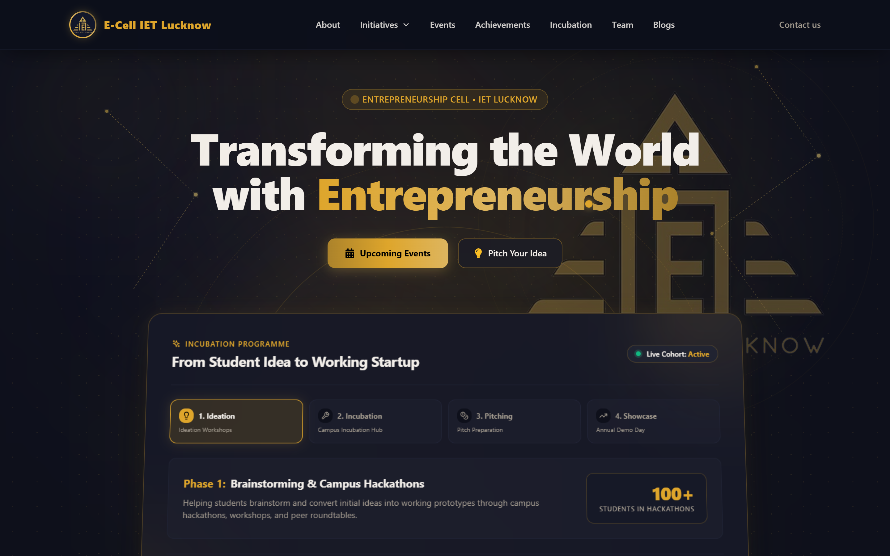
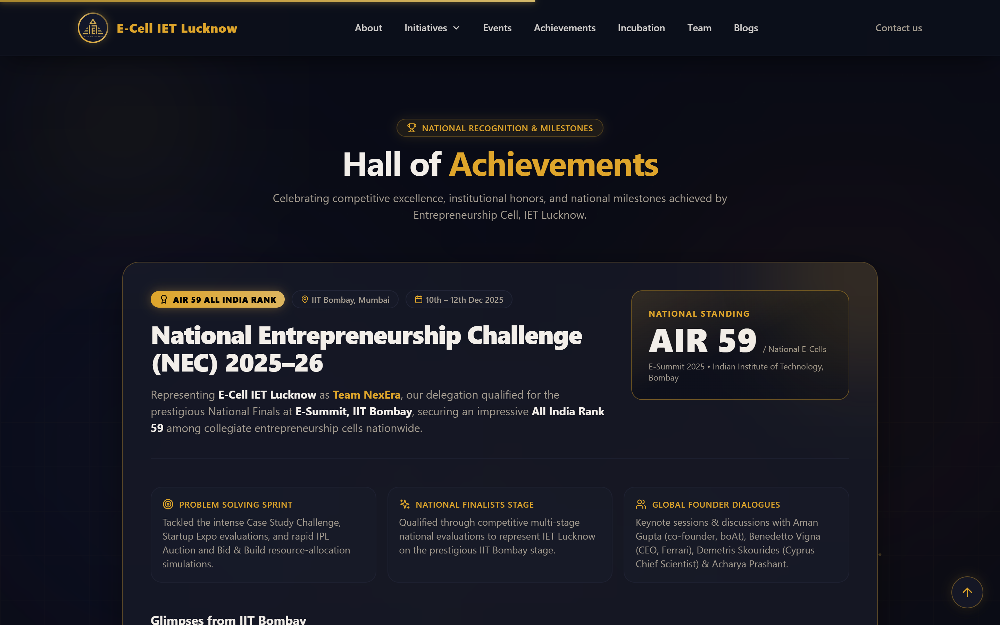
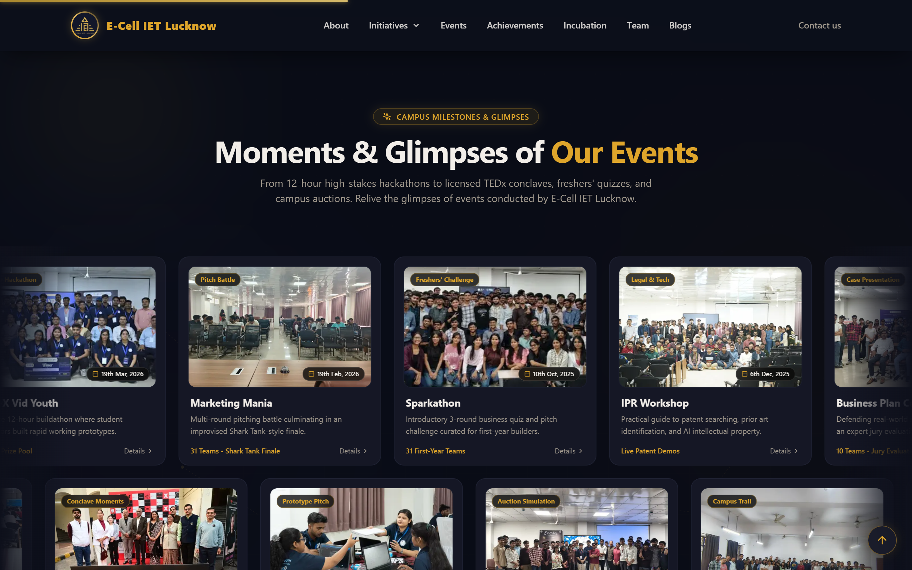
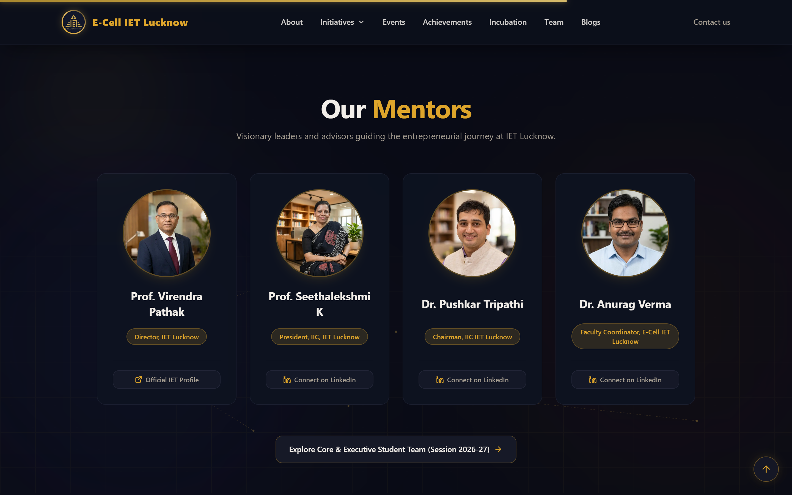
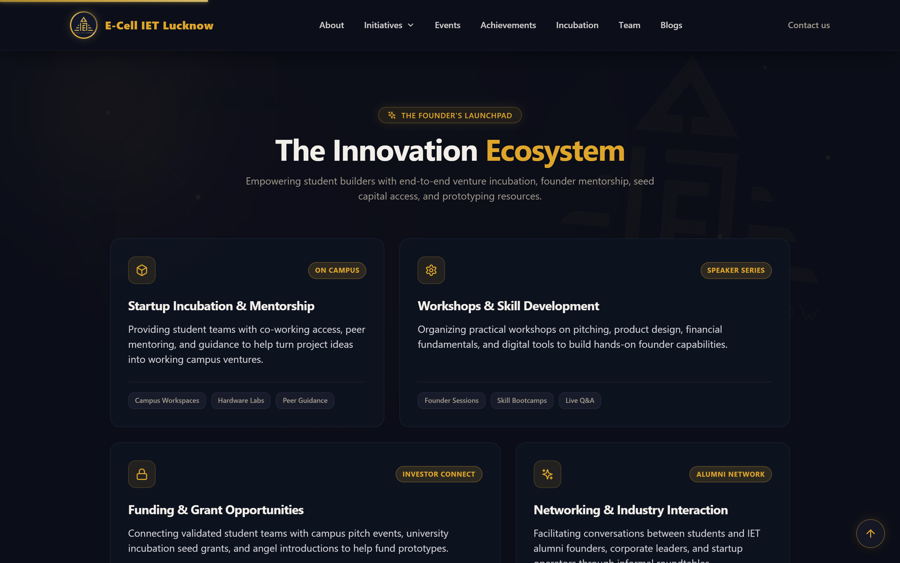
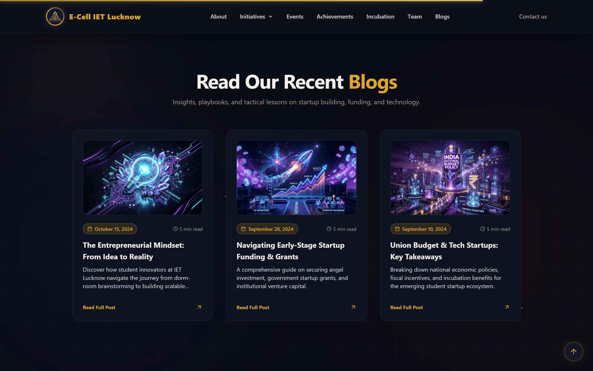
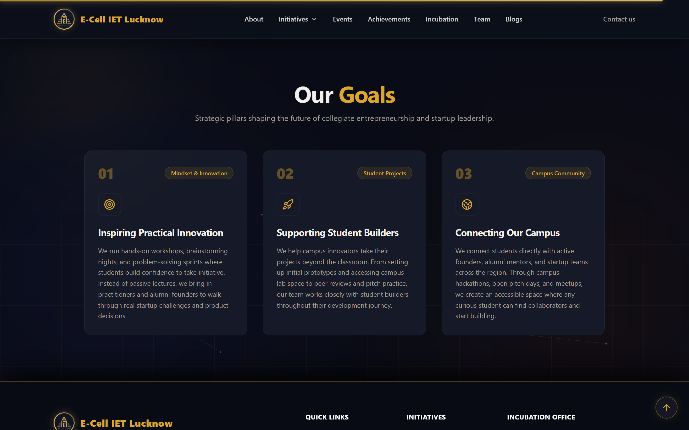
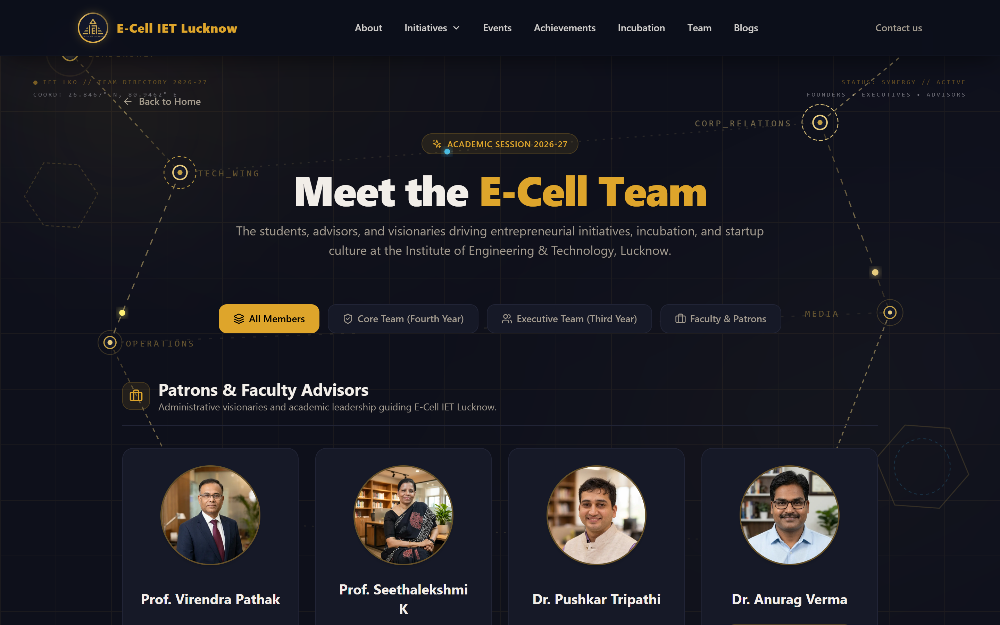

# 🚀 E-Cell IET Lucknow Website

Welcome to the official repository for the **Entrepreneurship Cell (E-Cell)** website of the **Institute of Engineering and Technology (IET), Lucknow**!  
This modern digital hub serves as the front for showcasing events, incubation initiatives, student startups, and entrepreneurial resources aimed at fostering startup culture across the campus.

---

## 🌐 Live Website

🔗 **[Visit the Live Website](https://e-cell-iet-lko.vercel.app/)**

---

## 📸 Screenshots

### 🏠 Homepage & Incubation Roadmap
<p align="center">
  
</p>

### 🏆 Hall of Achievements (NEC 2025-26 & AIR 59 at IIT Bombay)
<p align="center">
  
</p>

### 🎪 Flagship Events & Showcase Gallery
<p align="center">
  
</p>

### 👔 Visionary Mentors & Faculty Leadership
<p align="center">
  
</p>

### 💡 The Innovation Ecosystem & Startup Services
<p align="center">
  
</p>

### 📰 Latest Insights & Entrepreneurial Blogs
<p align="center">
  
</p>

### 🎯 Our Mission & Strategic Goals
<p align="center">
  
</p>

### 👥 Student Leadership Team Directory
<p align="center">
  
</p>

---

## 🛠️ Modern Tech Stack

- **Framework:** [Next.js 14](https://nextjs.org/) (App Router)
- **Language:** [TypeScript](https://www.typescriptlang.org/)
- **Styling:** [Tailwind CSS](https://tailwindcss.com/) with Custom Gold Glow Theme
- **Animations:** [Framer Motion](https://www.framer.com/motion/) & CSS keyframe kinetics
- **3D / Visuals:** [Three.js](https://threejs.org/) & [Three-Globe](https://github.com/vasturiano/three-globe)
- **Icons:** [Lucide React](https://lucide.dev/) & [Tabler Icons](https://tabler-icons.io/)
- **Deployment:** [Vercel](https://vercel.com/)

---

## 📁 Project Structure

```
E-cell/
│
├── app/                        # Next.js 14 App Router
│   ├── blogs/                  # Dedicated blogs directory & article view
│   ├── events/                 # Detailed events page
│   ├── initiatives/            # Incubation & startup initiatives
│   ├── team/                   # Full student team & mentors directory
│   ├── layout.tsx              # Root layout with fonts & providers
│   ├── page.tsx                # Dynamic homepage assembly
│   └── globals.css             # Tailwind base & custom animations
│
├── components/                 # Reusable UI & section components
│   ├── ui/                     # Animated backgrounds, glow cursors, sticky bars
│   ├── AchievementsSection.tsx # NEC IIT Bombay AIR 59 achievements showcase
│   ├── EventsSection.tsx       # Dual-marquee dynamic event slider
│   ├── Hero.tsx                # Hero banner & interactive incubation roadmap
│   ├── Jordon.tsx              # Aligned faculty mentors cards
│   ├── Services.tsx            # What we do & incubation pillars
│   ├── Blogssec.tsx            # Curated recent startup articles
│   ├── Approach.tsx            # Vision & strategic goals
│   ├── TopNavbar.tsx           # Persistent sticky navigation bar
│   └── Footer.tsx              # Quick links, social channels & credits
│
├── data/                       # Structured content & metadata
├── public/                     # High-resolution screenshots & assets
├── package.json
└── README.md
```

---

## 📌 Key Features

- **🏆 Hall of Achievements:** Dedicated spotlight celebrating **Team NexEra** reaching the National Finals of the **National Entrepreneurship Challenge (NEC) 2025–26** at **E-Summit, IIT Bombay**, achieving **All India Rank 59** among collegiate entrepreneurship cells nationwide.
- **🚀 Interactive Incubation Roadmap:** Step-by-step interactive tabs guide student founders from Ideation & Prototyping to Incubation, Pitching, and Annual Demo Day, paired with an integrated pitch modal.
- **🎪 Dynamic Flagship Events Showcase:** Dual-direction smooth marquee carousel highlighting past conclaves, hackathons, speaker series, and workshops with full date and format badges.
- **👔 Aligned Faculty Mentors & Advisors:** Symmetrically formatted cards highlighting administrative leadership and faculty mentors with direct profile links.
- **👥 Comprehensive Team Directory:** Dedicated `/team` page detailing Core and Executive student leadership.
- **📰 Curated Startup Insights:** Rich entrepreneurial articles covering funding, pitch deck strategies, AI in business, and MVP creation.
- **✨ Premium Dark Aesthetic:** Glassmorphic cards, gold gradient accents, persistent sticky navigation, dynamic scroll progress, and custom ambient glowing effects.

---

## 🚀 Getting Started

### Prerequisites

- [Node.js](https://nodejs.org/) (v18.x or newer)
- npm or yarn

### Installation & Local Setup

1. **Clone the repository:**
   ```bash
   git clone https://github.com/vandandevbaranwal/E-CELL.git
   cd E-CELL
   ```

2. **Install dependencies:**
   ```bash
   npm install
   ```

3. **Run the local development server:**
   ```bash
   npm run dev
   ```

4. **Open in browser:**
   Navigate to [http://localhost:3000](http://localhost:3000) to view the application live.

---

## 🤝 Contributing

Contributions, feedback, and suggestions are always welcome!  
Feel free to open an issue or submit a pull request to help improve the platform.

---

## 🧑‍💻 Credits & Contributors

- **Redesigned & Developed by:** [Vandan Dev](https://www.linkedin.com/in/vandandevbaranwal) (EE'29, IET Lucknow)
- **Original Project by:** [Shivansh Kaushik](https://github.com/PhantomPhreak007)

---

<p align="center">
  <b>Entrepreneurship Cell • Institute of Engineering and Technology, Lucknow</b>
</p>
